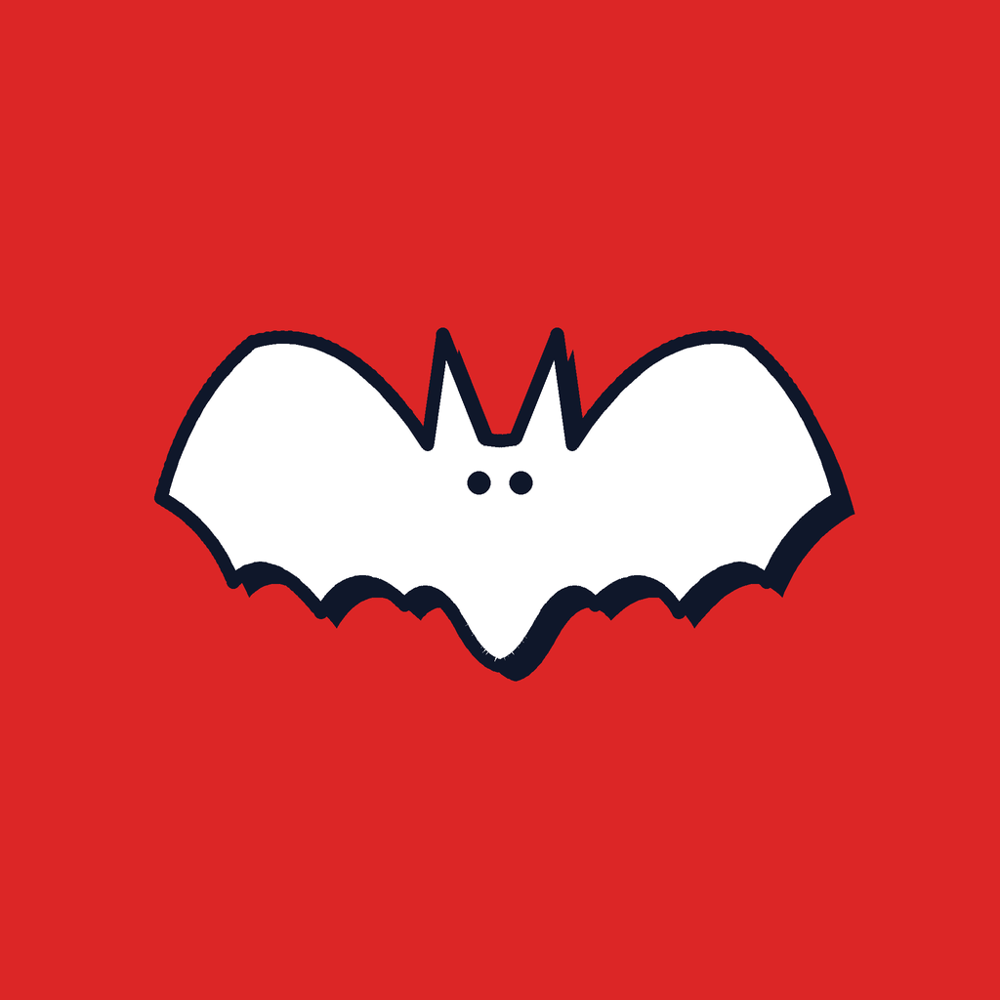

# 🦇 Wing Run


**Wing Run** is a 2D endless arcade-style obstacle-avoidance game built with **Flutter and Dart**. Take control of a flying bat, move up and down to navigate through incoming obstacle columns, and survive as long as possible to earn a high score.

The game is designed for landscape play and features a retro-inspired pixel-art interface, sound effects, background music, multiple local player profiles, and a persistent leaderboard.

## 🎮 Game Preview



*The image above is the app artwork currently included in the repository.*

## ✨ Features

- **Endless obstacle-avoidance gameplay:** guide the bat through gaps between moving columns.
- **Simple touch controls:** press and hold the up and down controls to steer the bat.
- **Increasing difficulty:** obstacles move faster as the run continues.
- **Score tracking:** earn points while staying alive and try to beat your personal best.
- **Local player profiles:** create, rename, delete, and switch between player profiles.
- **Leaderboard:** compare the best scores saved on the device.
- **Pause and restart:** pause a run, resume it, restart after a game over, or return to the home screen.
- **Sound and music:** background music and a collision sound effect.
- **Retro-inspired interface:** pixel-style typography, a bat sprite, and animated obstacle decorations.
- **Offline local data:** player profiles and best scores are stored locally with SQLite.

## 🕹️ How to Play

1. Open Wing Run and create a player profile when prompted.
2. Tap **Start Game**.
3. Hold the **Up** control to move the bat upward.
4. Hold the **Down** control to move the bat downward.
5. Pass through the gaps between obstacle columns.
6. Avoid touching the obstacles or the top and bottom boundaries of the play area.
7. Stay alive to increase your score. When the run ends, restart and try to beat your best score.

The obstacle speed increases over time, so the longer you survive, the more challenging the game becomes.

## 🧰 Built With

| Technology | Purpose |
| --- | --- |
| [Flutter](https://flutter.dev/) | Cross-platform application UI and rendering |
| [Dart](https://dart.dev/) | Application and game logic |
| [sqflite](https://pub.dev/packages/sqflite) | Local SQLite database for player profiles and scores |
| [audioplayers](https://pub.dev/packages/audioplayers) | Background music and sound effects |
| [path](https://pub.dev/packages/path) | Database file path handling |
| Custom assets and fonts | Bat sprite, audio, and retro-style typography |

## 📥 Download the Project

You can download the source code to your computer in either of these ways.

### Option 1: Clone with Git

Make sure [Git](https://git-scm.com/downloads) is installed, then open a terminal and run:

```bash
git clone https://github.com/JosueEtta/wing-run.git
cd wing-run
```

### Option 2: Download ZIP

1. Open the [Wing Run repository](https://github.com/JosueEtta/wing-run).
2. Click the green **Code** button.
3. Select **Download ZIP**.
4. Extract the ZIP file to a folder on your computer.
5. Open that folder in Android Studio or Visual Studio Code.

## ⚙️ Run the Project Locally

### Requirements

Install the following before running the project:

- [Flutter SDK](https://docs.flutter.dev/get-started/install)
- Dart (included with Flutter)
- [Android Studio](https://developer.android.com/studio) or [Visual Studio Code](https://code.visualstudio.com/)
- An Android emulator or a physical Android device for Android testing

Check that Flutter is correctly installed:

```bash
flutter doctor
```

### Install dependencies

From the project root directory, run:

```bash
flutter pub get
```

### Start the game

Connect an Android phone with USB debugging enabled, or start an emulator. Then run:

```bash
flutter devices
flutter run
```

You can also open the project in Android Studio or VS Code and use the Run command.

### Build an Android APK

To create a release APK, run:

```bash
flutter build apk --release
```

When the build succeeds, the APK will be available at:

```text
build/app/outputs/flutter-apk/app-release.apk
```

Transfer the APK to an Android device and install it. Android may ask you to allow installation from that source.

## 🗂️ Project Structure

The main source files and folders are organized as follows:

```text
wing-run/
├── android/                 # Android platform project
├── ios/                     # iOS platform project
├── web/                     # Web platform project
├── assets/
│   ├── audio/               # Background music and sound effects
│   ├── fonts/               # Pixel-style fonts
│   ├── Bat.png              # Bat game sprite
│   └── wingrun.png          # App icon and splash artwork
├── lib/
│   ├── component/           # Game components
│   ├── data/                # SQLite database and player data
│   ├── screens/             # Home and gameplay screens
│   ├── widgets/             # Reusable interface components
│   ├── audio.dart           # Music and sound management
│   ├── main.dart            # Application entry point
│   └── theme.dart           # App colors and styling
├── test/                    # Automated tests
├── LICENSE                  # MIT License
└── pubspec.yaml             # Dependencies and Flutter asset configuration
```

## 💾 Local Data

Wing Run uses SQLite on the device to save player profiles, the selected player, and each player's best score. This data is stored locally on the device; it is not a cloud-synchronised leaderboard.

Uninstalling the application or clearing its app data may remove locally stored game data.

## 🤝 Contributing

Contributions, suggestions, and bug reports are welcome.

1. Fork this repository.
2. Create a branch for your changes:

   ```bash
   git checkout -b feature/your-feature
   ```

3. Commit your changes:

   ```bash
   git commit -m "Add your feature"
   ```

4. Push your branch and open a Pull Request.

## 📄 License

Wing Run is open-source software licensed under the **MIT License**.

You are free to use, copy, modify, merge, publish, distribute, sublicense, and sell copies of the software, provided that the original copyright notice and the MIT License text are included with substantial portions of the software.

See the [LICENSE](LICENSE) file for the complete license terms.

**Copyright (c) 2026 Atabe Sikadi Josué Etta**

---

**Made with Flutter. Have fun, and see how far you can fly!**
